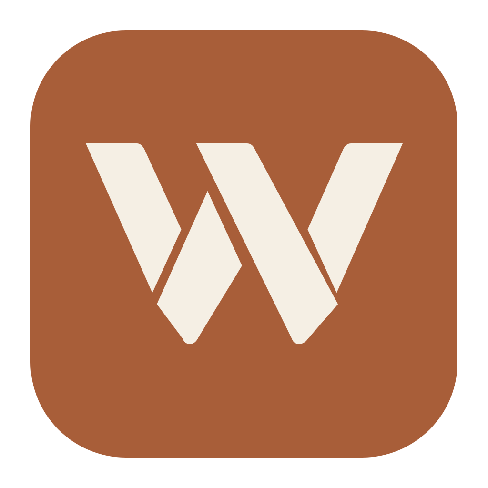

# Weft

A local coding agent for exploring projects, editing files, running commands, and delegating work—with a desktop interface that lets you inspect what happened.
- **See the work:** inspect model requests, responses, tool calls, request counts, and provider-reported usage.
- **Choose how to delegate:** run concurrent Sub-agents with different models and reasoning levels.
- **Keep your history locally:** Projects, Chats, settings, and task records stay on your machine. Model requests are sent to your configured provider.
- **Work in English or Chinese:** both interface languages are supported.

## Get started

The desktop app currently supports **macOS on Apple Silicon** and is built locally from source. Building requires Git, **Node.js 24+**, and **pnpm 11**. You also need an **OpenRouter API key** to use models.

```sh
git clone https://github.com/tylerlong/weft.git
cd weft
pnpm install
pnpm desktop:start
```

This builds and opens `desktop-output/Weft.app`. Afterward, open it from Finder; the built app does not need a terminal, the checkout, pnpm, or a separate Node installation. The first build downloads its runtimes. There is no automatic updater; quit Weft and rebuild to apply source changes.
1. Open **Settings → Models**, save your OpenRouter API key, wait for discovery, and add an available model.
2. Create a **Project** and select the folders you want to work with.
3. Create a **Chat**, choose a model and reasoning level, and submit a task.

Discovery uses your saved key’s access settings. It refreshes at startup, when Settings opens, after a different key is saved, and on Retry. Changing keys preserves configured models and Chat selections; see [Models](docs/user-guide.md#models-and-provider-routing) for unavailable models and recovery.

Install the tools your tasks need, such as Git, project runtimes, or Docker. Chrome or Edge is needed only for browser tasks. For the server/browser alternative, see [running from source](docs/development.md#server-and-browser-workflow).

## Before your first task

- **Weft has your system user's access.** Tools can read files and run commands. Safety Review is enabled by default, but it is not a sandbox.
- **Your database contains unencrypted credentials.** Desktop data is stored at `~/Library/Application Support/Weft/weft.sqlite`; keep it private. Model requests can include prompts, file contents, and tool results.
- **Closing the window keeps tasks running.** Use **Quit / Cmd+Q** to exit. If work or queued input exists, Weft asks for confirmation; quitting stops work and discards unstarted queued input.

## Learn more

- [User guide](docs/user-guide.md): models, task controls, Skills, images, browser access, integrations, and data.
- [Troubleshooting](docs/user-guide.md#troubleshooting): startup, rebuilds, browser access, and database errors.
- [Documentation index](docs/README.md): user guides, developer reference, design decisions, and validation records.
